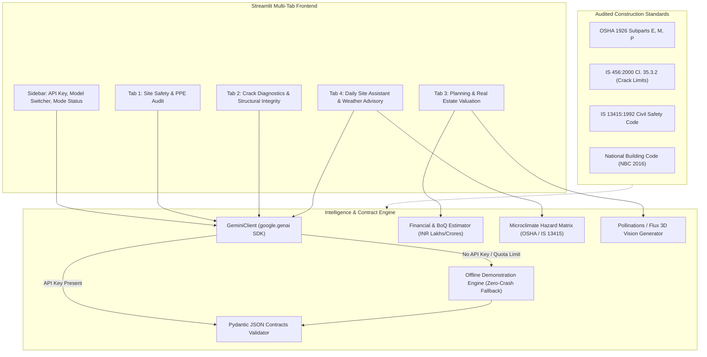

# Multimodal Construction Intelligence Platform
### Skill Wallet Capstone Project 1 • Generative AI & Real Estate Decision Support
**Platform ID:** `6ac4c98d1dcde6d7857c1642` | **Version:** `1.0.0-PROD`

---

## 📌 Executive Summary
The **Multimodal Construction Intelligence Platform** is an enterprise-grade AI decision-support system tailored for civil engineering contractors, structural auditors, and real estate developers. 

The system leverages state-of-the-art Multimodal Vision LLMs (Google Gemini 2.5 / 1.5) to inspect active construction site photos, audit worker Personal Protective Equipment (PPE) compliance under **OSHA 1926** and **IS 13415**, classify concrete cracks and structural distress under **IS 456:2000**, forecast Indian real estate asset valuation and BoQ material requirements in **INR (Lakhs / Crores)**, generate conceptual 3D architectural renders via **Pollinations / Flux AI**, and govern site operations via a **weather-aware safety matrix** and multi-turn engineering chatbot.

---

## 📋 Kanban Epics Coverage Matrix

| Epic | Module | Key Features & Regulatory Standards | Status |
| :--- | :--- | :--- | :---: |
| **Pre-requisites** | Environment & Foundations | Python 3.9+, Streamlit, Modern CSS UI, Pillow, Plotly | **Completed** ✅ |
| **Epic 1** | Requirements & Env | Secure Gemini API key input, graceful demo fallback, sidebar system topology | **Completed** ✅ |
| **Epic 2** | PPE Vision & Crack Diagnostics | OSHA 1926, IS 13415:1992, IS 456:2000 Clause 35.3.2 crack width metrology & repair BoQ | **Completed** ✅ |
| **Epic 3** | Valuation & Project Planning | Indian Real Estate valuation (Tier 1/2/3), CapEx incurred/remaining, Steel (MT) & Cement (Bags) BoQ, Pollinations 3D Flux renders | **Completed** ✅ |
| **Epic 4** | Multimodal AI & JSON Contracts | Strict Pydantic contracts (`PPEAuditResponse`, `CrackDiagnosticResponse`), robust JSON parsing & error recovery | **Completed** ✅ |
| **Epic 5** | Site Assistant & Weather Advisory | Dynamic microclimate hazard matrix (High Wind, Heavy Rain, Extreme Heat), crane free-slew & concrete curing protocols, multi-turn civil AI chat | **Completed** ✅ |
| **Epic 6** | Testing & Cloud Deployment | Unit test suite (`tests/test_platform.py`), zero-DB architecture, 1-click Streamlit Community Cloud ready | **Completed** ✅ |

---

## 🏗️ System Architecture & Data Flow



---

## 🛠️ Core Functional Modules

### 1. Tab 1 - Site Safety & PPE Audit (Epic 2)
- **Vision Ingestion:** JPG/PNG file uploader with a 1-click **"Load Sample High-Rise Site Photo"** button for immediate evaluation.
- **Multimodal Compliance Audit:** Inspects worker adherence for:
  - Industrial Safety Helmets (**IS 2925 / EN 397**)
  - High-Visibility Reflective Outerwear (**IS 15809 / EN ISO 20471**)
  - Steel-Toe Safety Footwear (**IS 15298 / ASTM F2413**)
  - Fall Protection Harnesses & Lifelines (**IS 3521 / OSHA 1926 Subpart M**)
  - Uncapped rebar dowels, electrical hazards, and open floor edges.
- **Visual Analytics:** Metric cards, safety score benchmark gauge (0–100), detection checklist with color-coded status badges, and expandable remediation action items.
- **Data Export:** Downloadable structured JSON safety audit report.

### 2. Tab 2 - Crack Diagnostics & Structural Integrity (Epic 2)
- **Defect Metrology & Classification:** Classifies concrete/wall defects into **Hairline**, **Settlement**, **Structural Shear**, **Thermal Expansion**, or **Spalling & Rebar Corrosion**.
- **IS 456:2000 Limit State Serviceability:** Evaluates crack width against permissible thresholds (0.3mm for mild/moderate exposure, 0.2mm for severe, 0.1mm for extreme).
- **Engineering Repair Protocols:** Generates tailored repair actions (low-viscosity epoxy pressure injection under ASTM C881, CFRP laminate wrapping, structural re-grouting).
- **Urgency & Cost Estimation:** Specifies immediate stabilization timeline and repair budget range in INR.
- **Data Export:** Downloadable forensic crack diagnostic JSON report.

### 3. Tab 3 - Planning & Real Estate Valuation (Epic 3)
- **Indian Real Estate Parametric Inputs:**
  - Typologies: Residential High-Rise (G+20), Commercial Grade-A Complex, Luxury Villa, Industrial Logistics PEB, Mixed-Use.
  - Built-up floor plate area (sq ft) and completion progress slider (0% to 100%).
  - Location Tiers: Tier 1 (Mumbai, Bengaluru, Delhi-NCR, Hyderabad), Tier 2 (Pune, Ahmedabad, Kolkata, Kochi), Tier 3 (Indore, Coimbatore, Nagpur).
  - Material Specifications: Standard, Premium, and Luxury Sustainable grades.
- **Financial Outputs:** Total project CapEx, incurred expenditure, remaining CapEx, and current asset market valuation in INR (formatted in Lakhs & Crores).
- **Material BoQ Forecaster:** Computes Structural Steel (MT) and Cement (Bags / MT) consumption with milestone progress bars, plus embodied carbon footprint (~tCO₂e).
- **Conceptual 3D Architectural Rendering:** Integrates with **Pollinations AI / Flux API** to generate 8K photorealistic architectural perspective visualizations matching building typology, lighting conditions, and architectural styles.

### 4. Tab 4 - Daily Site Assistant & Weather-Aware Advisory (Epic 5)
- **Microclimate Hazard Matrix:** Real-time safety protocols for:
  - High Wind (> 45 km/h / Gale Gusts): Mandatory crane weather-vaning (free-slew mode) and suspension of work at height.
  - Heavy Rain / Monsoon (> 30 mm/hr): Concreting shutdown, basement pump isolation, slope slippage warnings.
  - Extreme Heat (> 40°C): IS 7861 hot weather concreting (chilled water, retarders, split shifts).
  - Fog / Low Visibility & Severe Thunderstorms.
- **Interactive Site Assistant Chatbot:** Multi-turn civil engineering assistant equipped with IS 456, OSHA, and NBC 2016 knowledge. Features one-click preset engineering questions.

---

## ⚡ Demonstration Mode (Graceful Offline Fallback)
The platform is designed for **100% turnkey presentation readiness**:
- If no Google Gemini API key is provided, the platform automatically engages **Demonstration Mode**.
- Synthetic high-fidelity forensic data and technical guidance adhering strictly to OSHA 1926 and IS 456:2000 are served.
- Bundled sample images allow instant evaluation of both PPE Vision and Crack Diagnostics with a single click.
- **The application never crashes due to missing credentials or network API limits.**

---

## 🚀 Quickstart & Local Installation

### 1. Prerequisites
- Python 3.9+ (Python 3.10, 3.11, 3.12, 3.13, 3.14 supported)
- pip or virtualenv

### 2. Setup Virtual Environment
```bash
# Clone the repository and navigate into directory
cd "Multimodal-Construction-Intelligence-Platform"

# Create virtual environment
python3 -m venv .venv
source .venv/bin/activate    # On Windows: .venv\Scripts\activate

# Install dependencies
pip install -r requirements.txt
```

### 3. Launch Application
```bash
streamlit run app.py
```
Open your browser at `http://localhost:8501`.

### 4. Run Automated Tests
```bash
python3 -m unittest discover tests
```

---

## ☁️ Deployment Guide (Streamlit Community Cloud)

This application has **zero external database dependencies** (SQLite/PostgreSQL are not required; session state and in-memory caches are leveraged), making it seamlessly deployable on Streamlit Community Cloud:

1. Push this repository to GitHub.
2. Visit [share.streamlit.io](https://share.streamlit.io) and click **"New app"**.
3. Select your repository, branch (`main`), and set Main file path to `app.py`.
4. *(Optional)* Add your `GEMINI_API_KEY` under **Advanced Settings > Secrets**:
   ```toml
   GEMINI_API_KEY = "your-api-key-here"
   ```
5. Click **Deploy!** Your cloud platform is live in under 60 seconds.

---

## 📦 Directory Structure

```
├── app.py                     # Master Streamlit turnkey entry point
├── config.py                  # Platform metadata, Indian real estate rates, weather protocols
├── requirements.txt           # Deployment dependencies
├── .streamlit/
│   └── config.toml            # Dark corporate construction theme & server configuration
├── modules/
│   ├── __init__.py
│   ├── gemini_client.py       # Multimodal GenAI client, Pydantic JSON contracts & demo fallback
│   ├── ppe_audit.py           # Tab 1: PPE inspection, OSHA/IS 13415 metrics, gauge charts
│   ├── crack_diagnostics.py   # Tab 2: Defect classification, IS 456 crack metrology & repairs
│   ├── valuation_planning.py  # Tab 3: INR real estate valuation, CapEx, BoQ materials
│   ├── pollinations_render.py # Tab 3: Pollinations / Flux 3D architectural rendering integration
│   ├── weather_advisory.py    # Tab 4: Dynamic microclimate hazard matrix & alert protocols
│   └── chatbot_assistant.py   # Tab 4: Multi-turn civil engineering site chatbot assistant
├── assets/
│   ├── custom.css             # High-end dark corporate glassmorphism stylesheet
│   ├── generate_sample_images.py # Standalone image generator
│   ├── sample_ppe_site.jpg    # Pre-rendered sample construction site inspection photo
│   └── sample_crack_defect.jpg# Pre-rendered sample concrete shear crack photo
├── tests/
│   ├── __init__.py
│   └── test_platform.py       # Automated smoke & integration unit tests
└── README.md                  # Comprehensive platform documentation
```

---

## ⚖️ Standards & Regulatory Compliance
- **OSHA 1926:** Safety and Health Regulations for Construction (Subpart E: PPE, Subpart M: Fall Protection, Subpart P: Excavations).
- **IS 456:2000:** Indian Standard Code of Practice for Plain and Reinforced Concrete (Section 35.3.2 Limit State of Serviceability - Cracking).
- **IS 13415:1992:** Code of Safety for Civil Engineering Construction and Demolition Works.
- **IS 7861 (Part 1 & 2):** Code of Practice for Extreme Weather Concreting (Hot and Cold Weather).
- **NBC 2016:** National Building Code of India (Structural Safety & Fire Protection).

